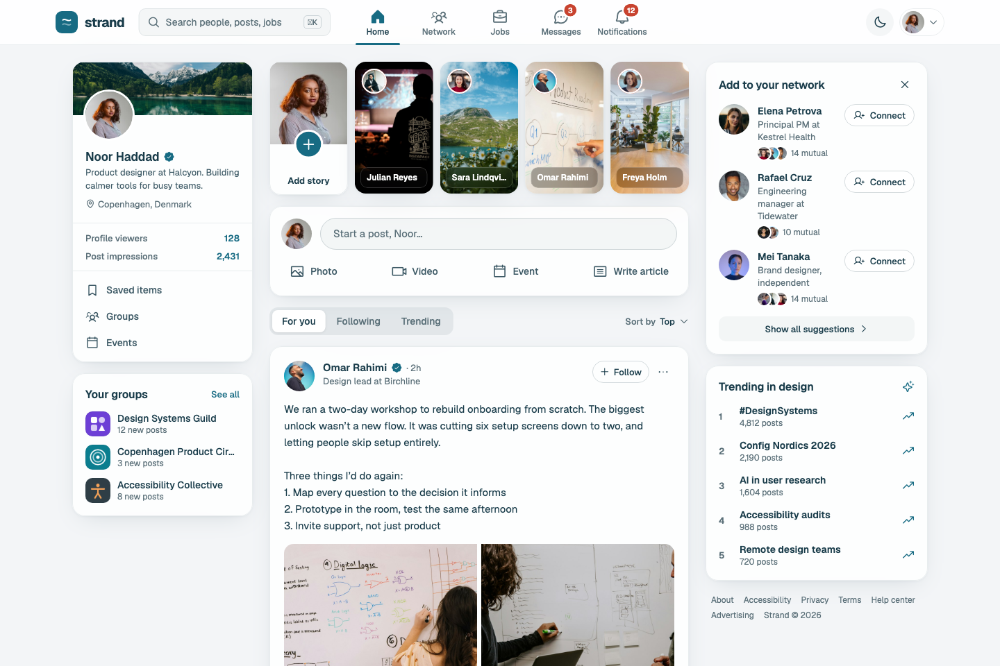

# finesse

[](https://pub.dev/packages/finesse)
[](https://github.com/vlidholt/finesse/actions/workflows/flutter-test.yaml)
[](LICENSE)

A design system for Flutter: more than a hundred widgets themed by one `ThemeData`, with frosted-glass surfaces, desktop and phone metrics in the same theme, motion on springs, and no dependency on Material or Cupertino.



See it in a whole app in [Demo](https://vlidholt.github.io/finesse_demo/), a small professional network built from `finesse` widgets ([source](https://github.com/vlidholt/finesse_demo)), and browse every component in the [component library](https://vlidholt.github.io/finesse/).

`finesse` is a fork of [shad](https://pub.dev/packages/shad), a Flutter port of [shadcn/ui](https://ui.shadcn.com). It keeps that component set and theming model, drops the `Shad` prefix, and adds its own default look and the pieces an app needs around the components: a scaffold, app and navigation bars, sheets, pickers, lists, page layout, and theme-driven spacing and motion.

## Features

- **Components.** Buttons, text fields, search and autocomplete, forms, dialogs, sheets on detents, action sheets, menus, popovers, toasts, tabs, a sidebar, a data table, a calendar, date, time and wheel pickers, sliders, chips, list sections and tiles, swipe actions, a reorderable list, a kanban board, a chat list with streaming text, avatars and badges, and more. Every one is a regular widget and composes with the rest of your tree.
- **One theme, two form factors.** Every style carries metrics for a desktop and for a phone. `FinesseApp` picks between them from the window width, so the same `Button` is 36 points tall in a desktop window and 44 on a phone, body text grows from 14 to 15, and page margins tighten, with no `if (isMobile)` in your code.
- **App structure.** `Scaffold` with drawers, a footer, a bottom sheet and a floating action button; `AppBar` and a collapsing `SliverAppBar`; a top `NavigationBar`, a floating `BottomNavigationBar` and a `NavigationRail`, with `NavigationScaffold` to switch between them; page routes with the iOS back swipe and Android's predictive back.
- **Glass.** Translucent cards, and bars, menus, popovers, tooltips and toasts that blur and saturate what is behind them, are part of the style, with tokens for blur and for the opacity of each kind of surface. `Glass` puts the same surface anywhere.
- **Motion from the theme.** Durations, curves and springs come from one `Motion` on the style: overlays grow from their anchor, selections travel, controls respond to a press, and the platform's reduced-motion setting is honoured everywhere. No component takes its own effects or durations.
- **Spacing from the theme.** A named gap scale (`Gap.md()`, `FinesseRow(gap: GapSize.lg)`) and `PageContainer` keep screens consistent and let a theme change their rhythm.
- **Styles and colour schemes.** Four styles (`finesse`, `nova`, `maia`, `lyra`) and four base palettes (`teal`, `neutral`, `zinc`, `stone`) in light and dark, 17 accent overlays, and every token overridable through `copyWith`.
- **Icons included.** The [Phosphor](https://phosphoricons.com) icon set ships in the package in six weights.
- **Forms.** `FinesseForm` and a `*FormField` widget for every input, with per-field validation.
- **Localization.** 82 locales, built on `slang`.
- **Material and Cupertino interop, opt-in.** `package:finesse/material.dart` themes Material and Cupertino widgets from the `finesse` theme, so both widget sets can share one page.

## Installation

```bash
flutter pub add finesse
```

## Usage

```dart
import 'package:flutter/widgets.dart';
import 'package:finesse/finesse.dart';

void main() {
  runApp(const MyApp());
}

class MyApp extends StatelessWidget {
  const MyApp({super.key});

  @override
  Widget build(BuildContext context) {
    return FinesseApp(
      theme: ThemeData(),
      darkTheme: ThemeData(brightness: Brightness.dark),
      themeMode: ThemeMode.system,
      home: const HomePage(),
    );
  }
}

class HomePage extends StatelessWidget {
  const HomePage({super.key});

  @override
  Widget build(BuildContext context) {
    return Center(
      child: Card(
        style: const CardTheme(width: 320),
        title: const Text('Create project'),
        description: const Text('Deploy your new project in one click.'),
        footer: Button(
          onPressed: () {},
          child: const Text('Deploy'),
        ),
        child: const TextField(placeholder: Text('Name of your project')),
      ),
    );
  }
}
```

The example app's component library gives the full reference. Each page pairs a live preview with the exact source that renders it, and there are guides on theming, styles, typography, fonts, icons, layout, form factors, motion, forms, overlays, and the building blocks for your own widgets. Run it with `cd example && flutter run`.

## Names

Widgets have no prefix: `Button`, `Card`, `Theme`, `ThemeData`. A name that would clash with Flutter's own widgets layer has a `Finesse` prefix instead (`FinesseApp`, `FinesseRow`, `FinesseColumn`, `FinessePadding`, `FinesseForm`, `FinesseTable`, `FinesseBorder`, `FinesseDecoration`). Some names are shared with Material (`Card`, `Switch`, `Dialog`, `Scaffold`, `AppBar`); in a file that imports both libraries, hide one side or import one with a prefix.

## Theming

`ThemeData()` is the default look: the `finesse` style on the teal palette. A theme is a style, a colour scheme and a text theme, and each can be replaced on its own:

```dart
ThemeData(
  style: StyleTokens.nova,
  colorScheme: const NeutralColorScheme.light().applyAccentScheme(
    AccentScheme.violetLight,
  ),
  radius: const BorderRadius.all(Radius.circular(6)),
)
```

A style is a set of measured tokens (control heights, radii, shadows, type roles, glass, spacing). Change any of them with `copyWith`; the change applies to the phone metrics too wherever they did not already differ:

```dart
ThemeData(
  style: StyleTokens.finesse.copyWith(
    cardOpacity: 1, // opaque cards
    gapLg: 20,
  ),
)
```

Every component also has its own theme on `ThemeData` (`cardTheme`, `chipTheme`, `appBarTheme`, …) for overrides that go beyond the tokens.

## Form factors

`FinesseApp` uses the phone metrics when the window is narrower than the theme's `md` breakpoint (768) and the desktop metrics otherwise; `formFactor:` pins one. Widgets size themselves from the theme, so most screens need no branching. Where a screen is *arranged* differently on a phone, branch on the theme rather than on the window:

```dart
FormFactorBuilder(
  mobile: (context) => const ConversationList(),
  desktop: (context) => const Row(
    children: [ConversationList(), Expanded(child: Conversation())],
  ),
)
```

## Layout

Name the relationship between two things and let the theme decide the number:

```dart
PageContainer(
  scrollable: true,
  child: FinesseColumn(
    gap: GapSize.lg, // 16 on a desktop, 12 on a phone
    crossAxisAlignment: CrossAxisAlignment.stretch,
    children: [
      const Text('Jobs'),
      FinesseRow(gap: GapSize.md, children: stats),
      const Gap.xl(),
      results,
    ],
  ),
)
```

`PageContainer` adds the theme's page margins, caps the width, and keeps content clear of a `Scaffold`'s bars while letting it scroll beneath them.

## Icons

The Phosphor icons are bundled, with no extra dependency:

```dart
const PhosphorIcon(PhosphorIconsRegular.house)
const PhosphorIcon(PhosphorIconsFill.house) // a selected state
const PhosphorDuotoneIcon(PhosphorIconsDuotone.bell)
```

Regular, bold, fill, light, thin and duotone weights are available. `PhosphorIcon` is an `Icon` that draws a small regular icon with a slightly thicker line, so a 16-point icon does not look thin beside a 24-point one; a plain `Icon` works too. A release build keeps only the glyphs your app uses. Phosphor Icons are MIT licensed; the notice is part of this package's `LICENSE`, which Flutter adds to your app's licence page.

## Fonts

`finesse` bundles no text fonts. Text uses the platform's font (SF on Apple platforms, Roboto on Android, Segoe UI on Windows) until you choose another one. There are two ways to choose:

**Google Fonts, fetched at runtime:**

```bash
flutter pub add google_fonts
```

```dart
ThemeData(
  textTheme: TextTheme.fromGoogleFont(GoogleFonts.inter),
)
```

Pass a static tear-off such as `GoogleFonts.inter`. Avoid `GoogleFonts.getFont(name)`: it keeps every Google font family in a web build. A closure made on every build would also make the theme unequal to itself, so every rebuild would count as a theme change.

**Your own font files:** add the files to your app, declare them in your `pubspec.yaml`, and name the family:

```yaml
flutter:
  fonts:
    - family: Inter
      fonts:
        - asset: fonts/Inter[opsz,wght].ttf
```

```dart
ThemeData(
  textTheme: TextTheme(family: 'Inter'),
)
```

The default look was designed around [Geist](https://vercel.com/font); the example app loads it with `GoogleFonts.geist`.

## Material and Cupertino

`package:finesse/finesse.dart` does not import Material or Cupertino, which Flutter is moving out of the SDK into the [`material_ui`](https://pub.dev/packages/material_ui) and [`cupertino_ui`](https://pub.dev/packages/cupertino_ui) packages. To use Material or Cupertino widgets in a `finesse` app, also import `package:finesse/material.dart` and wrap the app in a `FinesseMaterial`:

```dart
import 'package:finesse/material.dart';
import 'package:finesse/finesse.dart';

FinesseApp(
  builder: (context, child) => FinesseMaterial(child: child!),
  home: const HomePage(),
)
```

`FinesseMaterial` derives a Material theme from the `finesse` theme. It also adds the Material and Cupertino localizations and a transparent `Material`, which widgets such as `TextField` and `Slider` need. To put `finesse` widgets inside your own `MaterialApp`, use `FinesseApp.custom` and `materialThemeFrom(Theme.of(context))`. `package:finesse/material.dart` uses the Material and Cupertino libraries that ship in the Flutter SDK.

## Platform support

Android, iOS, macOS, Windows, Linux and the web, including WebAssembly. The package needs Flutter 3.50 or later.

## Versioning

`finesse` is at 0.x: the API can still change between minor versions, and each change is listed under "Changed" in the [changelog](CHANGELOG.md). There are no deprecation shims.

## Repository layout

| Path | Contents |
| --- | --- |
| `lib/` | The `finesse` package. |
| `fonts/phosphor/` | The bundled Phosphor icon fonts and their licence. |
| `example/` | The component library: a page per component with live previews and their source, guides, and a theme editor that restyles it all. Deployed to <https://vlidholt.github.io/finesse/>. The demo app is in its own repository, [finesse_demo](https://github.com/vlidholt/finesse_demo). |
| `test/` | The package's test suite. |
| `skills/finesse-overview/` | An [Agent Skill](https://agentskills.io) describing `finesse`'s API, for coding agents. |

## Contributing

Contributions are welcome. See [CONTRIBUTING.md](CONTRIBUTING.md) for how to set up the project, run the test suite, and open a pull request. To report a security problem, see [SECURITY.md](SECURITY.md).

## Credits

`finesse` is a fork of [shad](https://github.com/serverpod/shad) by [Serverpod](https://serverpod.dev), which began as [flutter-shadcn-ui](https://github.com/nank1ro/flutter-shadcn-ui) by [Alexandru Mariuti](https://github.com/nank1ro). Its icons are [Phosphor Icons](https://phosphoricons.com), bundled under the MIT License.

## License

[MIT](LICENSE)
